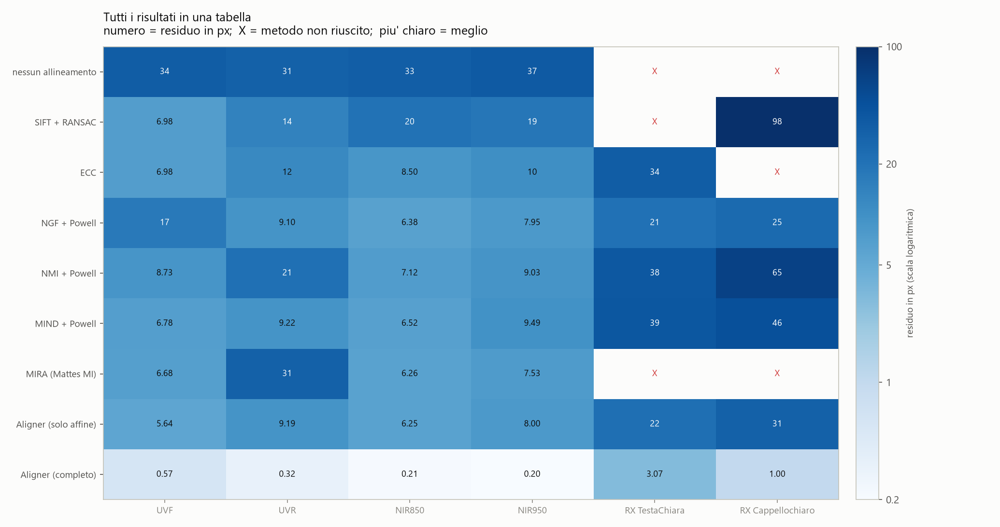
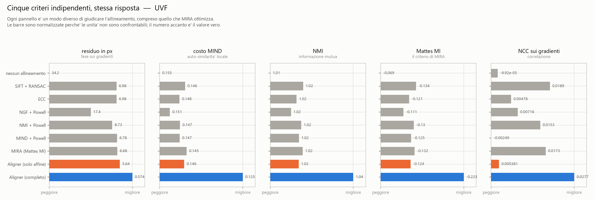
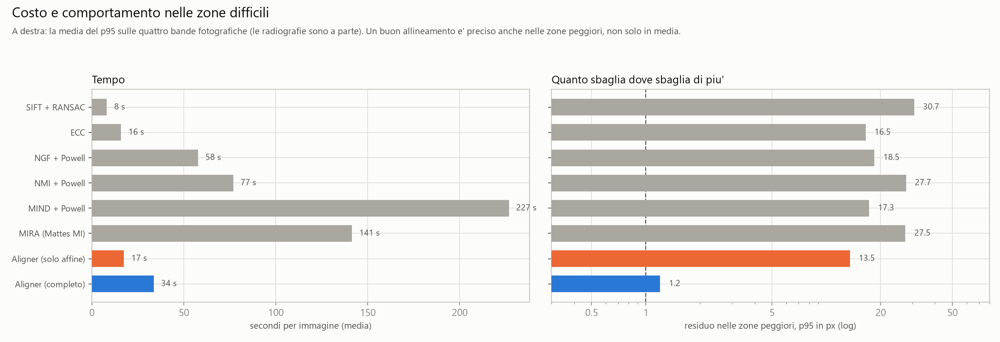
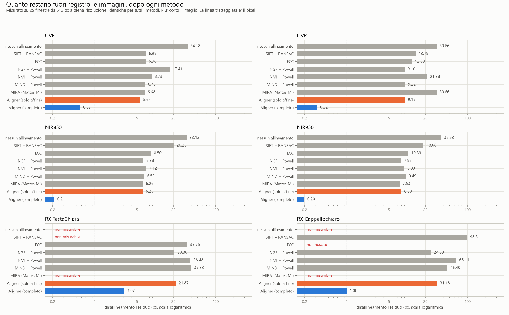
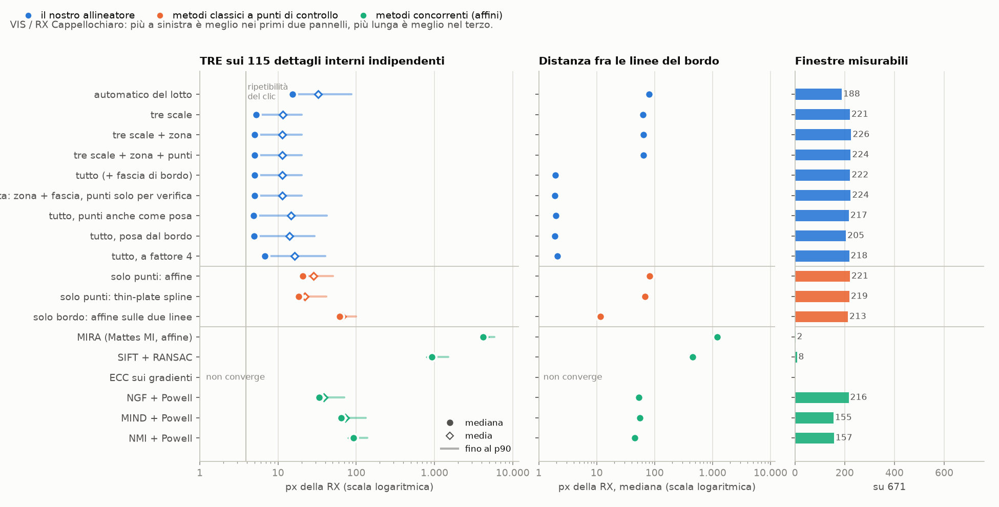
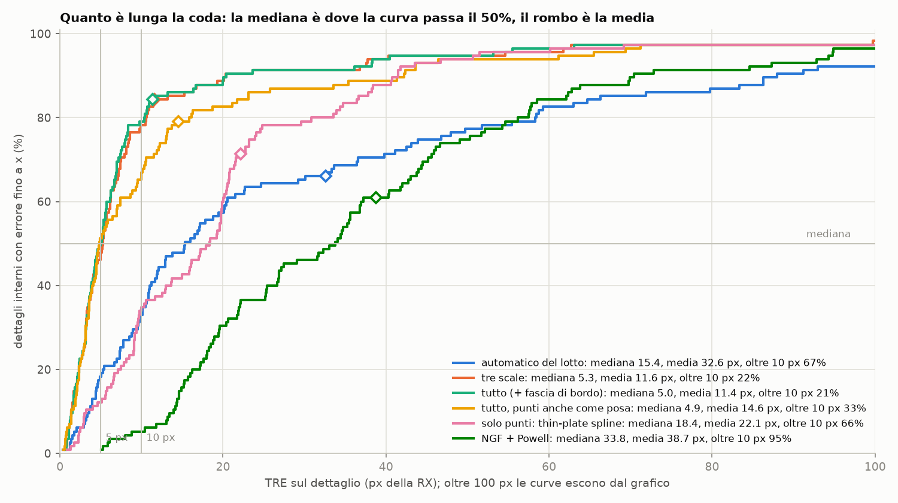
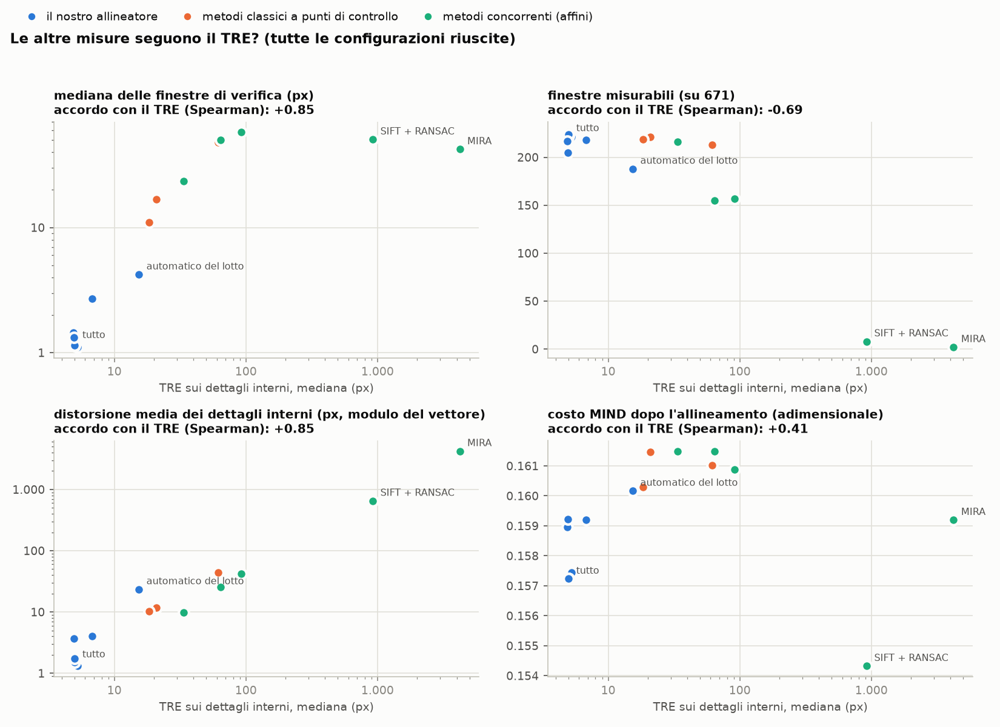

# Confronto fra metodi di allineamento

Otto metodi messi alla prova sulle stesse sei coppie di immagini, giudicati con
cinque criteri indipendenti. Tutto quello che c'è qui è riproducibile:

```powershell
python esegui.py      # esegue e misura (circa 1.5 ore)
python grafici.py     # produce le figure da risultati.json
```

I risultati grezzi sono in `risultati.json`, le figure in `figure/`.

---

## Cosa viene confrontato

| metodo | criterio | modello | risoluzione di lavoro |
|---|---|---|---|
| **Aligner (completo)** | fase sui gradienti, a blocchi | affine + campo non rigido | fattore 2 |
| **Aligner (solo affine)** | come sopra, senza campo | affine | fattore 2 |
| **MIRA** | Mattes Mutual Information (SimpleITK) | affine | piena risoluzione, ROI 60% |
| **MIND + Powell** | auto-similarità di vicinato | affine | piramide 16 → 8 |
| **NGF + Powell** | direzioni dei gradienti | affine | piramide 16 → 8 |
| **NMI + Powell** | informazione mutua normalizzata | affine | piramide 16 → 8 |
| **SIFT + RANSAC** | punti notevoli + CLAHE | affine | fattore 4 |
| **ECC** | correlazione, sui gradienti + CLAHE | affine | fattore 8 |

Immagini: **VIS come riferimento**, e come bersagli UVF, UVR, NIR850, NIR950 e
due radiografie (TestaChiara e Cappellochiaro).

## Come è stata garantita l'imparzialità

Questa è la parte che conta più dei numeri.

**Ogni metodo lavora alla risoluzione che gli è propria.** Il nostro a fattore 2
e MIRA a piena risoluzione perché è così che sono progettati; i metodi basati su
un ottimizzatore generico usano una piramide, che è il modo in cui vengono
normalmente impiegati. La risoluzione è dichiarata nella tabella: fa parte delle
caratteristiche del metodo, non è un dettaglio nascosto.

**Ogni metodo riceve le stesse cortesie.** Chi ha bisogno di una stima
grossolana di partenza la riceve (ECC e i metodi con Powell): senza,
fallirebbero per un motivo che non riguarda la loro capacità di allineare. Chi
beneficia del CLAHE lo riceve.

**La valutazione è identica per tutti**, sulle stesse 25 finestre da 512 px a
piena risoluzione, in posizioni scelte indipendentemente da come ciascun metodo
ha lavorato.

**Nessun metodo viene giudicato con il proprio criterio soltanto.** I cinque
criteri appartengono a famiglie diverse, e fra questi c'è la Mattes Mutual
Information, cioè esattamente ciò che MIRA ottimizza. Se il risultato dipendesse
dallo strumento di misura, i cinque criteri darebbero ordini diversi.

## Il risultato



**Sulle quattro bande fotografiche:**

| metodo | UVF | UVR | NIR850 | NIR950 |
|---|---|---|---|---|
| nessun allineamento | 34.18 | 30.66 | 33.13 | 36.53 |
| SIFT + RANSAC | 6.98 | 13.79 | 20.26 | 18.66 |
| ECC | 6.98 | 12.00 | 8.50 | 10.39 |
| NGF + Powell | 17.41 | 9.10 | 6.38 | 7.95 |
| NMI + Powell | 8.73 | 21.38 | 7.12 | 9.03 |
| MIND + Powell | 6.78 | 9.22 | 6.52 | 9.49 |
| MIRA | 6.68 | **30.66** | 6.26 | 7.53 |
| Aligner (solo affine) | 5.64 | 9.19 | 6.25 | 8.00 |
| **Aligner (completo)** | **0.57** | **0.32** | **0.19** | **0.19** |

Residui in pixel, mediana su 64 finestre. MIRA su UVR resta a 30.66, cioè
esattamente il valore di partenza: non si è mossa.

Per il nostro metodo, con intervallo di confidenza e coda:

| immagine | mediana | IC 90% | finestre oltre 5 px | finestre affidabili |
|---|---|---|---|---|
| UVF | 0.57 | 0.49–0.72 | 2% | 61/64 |
| UVR | 0.32 | 0.30–0.37 | 2% | 54/64 |
| NIR850 | 0.19 | 0.15–0.25 | 0% | 61/64 |
| NIR950 | 0.19 | 0.16–0.25 | 0% | 59/64 |

> **Nota sulla misura.** Questi numeri sono stati ricalcolati con 64 finestre
> di verifica. Una versione precedente ne usava 25 e dava valori diversi (per
> esempio 0.41 px su UVF invece di 0.57): con 25 finestre la mediana oscillava
> fra 0.35 e 0.67 px contro un valore vero di 0.50, quindi le differenze di
> circa un pixel fra i metodi affini erano dentro il rumore della misura. Il
> divario fra affine e campo non rigido, un ordine di grandezza, non dipende da
> questa scelta.

### Il fatto più importante non è che vinciamo

È che **tutti i metodi affini finiscono nello stesso intervallo**, 6.4–10 px nei
casi in cui funzionano. Criteri completamente diversi — istogrammi congiunti,
descrittori di vicinato, punti notevoli, correlazione, fase — convergono sullo
stesso muro.

Se il limite fosse nella *qualità della stima* non cadrebbero tutti così vicini.
Il limite è nel **modello**: esiste nelle immagini una componente di ~7 px che
nessuna trasformazione affine può descrivere. Aggiungere il campo non rigido la
rimuove, e il residuo crolla di venti volte.

### I cinque criteri concordano



Tutti e cinque mettono *Aligner (completo)* al primo posto, compresa la Mattes MI
che è il criterio di MIRA. La conclusione non dipende da come la si misura.

### Costo



Il nostro è anche fra i più rapidi (43 s contro i 141 di MIRA e i 227 di MIND +
Powell), e soprattutto è l'unico che resta preciso **anche nelle zone peggiori**:
p95 di 1.2 px contro i 13–29 px di tutti gli altri.

## Le radiografie: dove tutti falliscono



| metodo | RX TestaChiara | RX Cappellochiaro |
|---|---|---|
| MIRA | non misurabile | non misurabile |
| SIFT + RANSAC | non misurabile | 98.31 |
| ECC | 33.75 | non riuscito |
| NGF + Powell | 20.80 | 24.80 |
| NMI + Powell | 38.48 | 65.11 |
| MIND + Powell | 39.33 | 46.40 |
| Aligner (solo affine) | 21.87 | 31.18 |
| **Aligner (completo)** | **3.07** | **0.99** |

"Non misurabile" significa che dopo l'allineamento **nessuna** delle finestre di
verifica dà una misura affidabile: le due immagini non si somigliano abbastanza
perché la verifica dia un risultato.

Il nostro metodo è il migliore anche qui, ma i numeri vanno letti con prudenza:
su RX TestaChiara i 3.07 px di mediana convivono con il **30% delle finestre
oltre 5 px** e solo 23 finestre affidabili su 63; su Cappellochiaro le finestre
affidabili sono 11 su 64. È buono al centro e sbagliato ai bordi, non buono
ovunque, ed è per questo che entrambe vengono marcate "da controllare". Il
motivo è nel README principale: una radiografia condivide con il visibile solo
le zone ricche di biacca.

## Le radiografie, giudicate a fondo (ottobre 2026)

```powershell
python radiografie.py   # 17 configurazioni sulla coppia VIS / RX Cappellochiaro, ~25 min, senza scrivere immagini
python rx_tabella.py    # la tabella qui sotto, da rx_risultati.json
python grafici_rx.py    # le quattro figure figure/rx_*.png, da rx_risultati.json
```

La tabella precedente giudicava le radiografie con la sola verifica a finestre,
che sulla RX misura poco: 11 finestre affidabili su 64. Qui ogni configurazione
viene giudicata con tre criteri indipendenti fra loro, uguali per tutte:

- **i dettagli cliccati a mano** (`rx_giudici.json`, congelati il 4/10). I 115
  *interni* stanno ad almeno 250 px dal bordo e a più di 50 px da ciascuno dei
  17 punti usati come vincolo, quindi nessuna configurazione li vede. Gli 82
  *sul bordo* stanno entro 100 px dal contorno della zona;
- **la distanza fra le due linee del bordo**: il contorno della zona sul VIS e
  il bordo della tela tracciato sulla RX;
- **la verifica a griglia fissa** della sezione RX: sempre le stesse 671
  finestre, dentro la stessa zona.

Pixel della RX per i punti e le linee, del VIS per le finestre. Nessuna
immagine viene scritta.

| configurazione | interni: mediana | media | p90 | sul bordo | linee | finestre misurabili | mediana finestre | finestre oltre 10 px | minuti |
|---|---|---|---|---|---|---|---|---|---|
| automatico del lotto | 15.4 | 32.6 | 87.3 | 83.1 | 79.8 | 188/671 | 4.21 | 37 | 0.9 |
| tre scale | 5.3 | 11.6 | 20.2 | 63.2 | 62.5 | 221/671 | 1.11 | 8 | 0.9 |
| tre scale + zona | 5.0 | 11.3 | 20.2 | 67.4 | 64.8 | 226/671 | 1.13 | 12 | 1.3 |
| tre scale + zona + punti | 5.0 | 11.4 | 20.2 | 67.0 | 64.8 | 224/671 | 1.19 | 15 | 1.3 |
| **tutto (+ fascia di bordo)** | **5.0** | 11.4 | **20.3** | **24.4** | **1.9** | 222/671 | 1.19 | 15 | 1.6 |
| tutto, punti anche come posa | 4.9 | 14.6 | 41.8 | 27.5 | 2.0 | 217/671 | 1.45 | 34 | 2.1 |
| tutto, posa dal bordo | 4.9 | 14.0 | 29.5 | 27.0 | 1.9 | 205/671 | 1.33 | 22 | 1.9 |
| tutto, a fattore 4 | 6.8 | 16.3 | 40.3 | 29.9 | 2.1 | 218/671 | 2.71 | 50 | 1.1 |
| solo punti: affine | 20.8 | 28.3 | 50.8 | 79.2 | 82.2 | 221/671 | 16.77 | 167 | 0.0 |
| solo punti: thin-plate spline | 18.4 | 22.1 | 41.2 | 67.9 | 67.6 | 219/671 | 11.00 | 117 | 0.0 |
| solo bordo: affine sulle due linee | 61.5 | 66.7 | 99.7 | 47.9 | 11.6 | 213/671 | 47.98 | 212 | 0.0 |
| NGF + Powell | 33.8 | 38.7 | 70.2 | 69.7 | 53.5 | 216/671 | 23.56 | 190 | 0.9 |
| MIND + Powell | 64.2 | 72.8 | 132.5 | 76.6 | 55.3 | 155/671 | 50.21 | 147 | 3.8 |
| NMI + Powell | 91.6 | 87.8 | 138.1 | 86.9 | 45.7 | 157/671 | 57.62 | 157 | 1.4 |
| SIFT + RANSAC | 922 | 888 | 1491 | 1028 | 452 | 8/670 | 50.48 | 7 | 0.1 |
| MIRA (Mattes MI, affine) | 4218 | 4384 | 5846 | 4783 | 1196 | 2/663 | 42.15 | 2 | 1.2 |
| ECC sui gradienti | non converge | | | | | | | | |

Cosa dice:

- **Il salto vero lo fanno le tre scale**: i dettagli interni passano da 15.4 a
  5.3 px. Zona e punti come vincolo non cambiano l'interno. La fascia di bordo
  porta le linee da 65 a 1.9 px e i dettagli sul bordo da 67 a 24 px, senza
  toccare l'interno né la verifica.
- **Tre varianti hanno la stessa mediana ma una coda peggiore**: i punti usati
  anche come posa, la posa ricavata dal bordo e il fattore 4. Il p90 dei
  dettagli interni sale da 20 a 30–42 px, le finestre oltre 10 px da 15 a
  22–50. Guardando solo la mediana sembrerebbero equivalenti.
- **I metodi classici a punti di controllo** (affine o thin-plate spline dai
  soli 17 punti) restano a 18–21 px: 17 punti non bastano a descrivere la
  deformazione. Il lavoro lo fa il matching automatico, e i punti servono dove
  quello non arriva.
- **Il bordo da solo non dà l'interno**: l'affine che sovrappone le due linee le
  porta a 11.6 px, ma sposta l'interno di 61.5 px.
- **I metodi concorrenti** sono tutti affini e lavorano senza zona né punti.
  Il migliore, NGF + Powell, resta a 34 px. MIRA e SIFT divergono di migliaia di
  pixel ed ECC non converge. È lo stesso quadro del confronto precedente:
  sulla RX un'affine non basta, e i criteri d'immagine faticano a trovare la
  corrispondenza.
- Nessuna trasformazione si ripiega su se stessa: il determinante minimo dello
  jacobiano è 0.54 (configurazione completa).

**La coda dei dettagli interni.** Nella configurazione completa 10 dettagli
su 115 sbagliano di 36–150 px, e sono loro a portare la media a 11.4 px
(senza di loro è 5.6). Otto di questi stanno dove la verifica non misura niente
(nessuna finestra entro 800 px), quindi non si può dire se sbagli
l'allineamento o il clic. In due casi i clic vicini concordano con la
trasformazione (3–7 px): lì l'errore è probabilmente il clic, cioè due dettagli
diversi presi per lo stesso. Per questo la mediana resta il numero principale,
ma va letta insieme al p90 e alla mappa dei punti peggiori, non da sola.

Il fondo della misura sui punti è il clic stesso: lo stesso dettaglio,
cliccato due volte, differisce di 3.9 px di mediana. Una mediana di 5.0 px sui
dettagli interni è quindi vicina a quanto un giudice cliccato a mano può
misurare.

### I grafici



Per ogni configurazione: il TRE sui dettagli interni (pallino = mediana, rombo
= media, linea fino al p90), la distanza fra le due linee del bordo e quante
finestre di verifica si misurano. Scala logaritmica, perché MIRA e SIFT
finiscono a centinaia o migliaia di pixel.



La distribuzione intera del TRE. La mediana è dove la curva passa il 50%; la
quota oltre 5 o 10 px si legge sulle due verticali. Le prime tre curve del
nostro allineatore sono quasi sovrapposte fino al 50% e si separano nella coda:
è lì che si vede la differenza fra «tutto» e «punti anche come posa».



Le altre misure contro il TRE, configurazione per configurazione, con
l'accordo di rango (Spearman: +1 se ordinano le configurazioni allo stesso modo
del TRE, −1 se al contrario).

La quarta figura (`figure/rx_4_mappa.png`, che `grafici_rx.py` disegna avendo le
riprese) mostra dove stanno i dettagli che sbagliano di più nella configurazione
completa, rispetto alle finestre che la verifica riesce a misurare. Non è nel
repository perché ha il dipinto come sfondo.

### Come si comportano le misure

Il TRE (target registration error) è lo scarto fra dove la trasformazione
porta un dettaglio e dove l'abbiamo cliccato sull'altra immagine. È la misura
standard della registrazione d'immagini ed è l'unico giudice esterno: non usa
né le immagini né il metodo di stima. Ha due limiti. Il primo è il clic stesso:
lo stesso dettaglio cliccato due volte differisce di 3.9 px. Il secondo è che i
punti usati come vincolo non possono giudicare se stessi. Le altre misure, una
per una:

**Mediana e media del TRE.** Per la configurazione completa la mediana è 5.0 px
(intervallo al 90% per ricampionamento: 4.2–5.6), la media 11.4 px (8.1–15.0).
L'intervallo della media è cinque volte più largo: la media dipende da quali
dieci punti finiscono nel campione. Tolti i 10 dettagli peggiori su 115, la
media scende a 5.6 px. Il numero principale è la mediana.

**Quota oltre 5 e 10 px.** È ciò che la mediana non vede. «Tutto» e «punti
anche come posa» hanno la stessa mediana (5.0 e 4.9 px), ma oltre 10 px stanno
il 21% e il 33% dei dettagli. Le quote vanno sempre accanto alla mediana.
L'automatico del lotto ha il 67% oltre 10 px.

**Finestre misurabili (copertura).** Fra le configurazioni che funzionano si
muove poco (205–226 su 671), e non separa le buone dalle mediocri: «solo punti,
affine» ne misura 221 come «tutto», ma sbaglia di 20.8 px invece di 5.0.
Crolla invece quando l'allineamento è del tutto sbagliato (MIRA 2, SIFT 8).
È un allarme, non una misura di quanto è buono il risultato. Dice anche per
quanta parte del dipinto vale la mediana delle finestre: un terzo, sulla RX.

**Mediana delle finestre.** Concorda con il TRE (Spearman +0.88), ma ha due
limiti. È più bassa del TRE (1.2 px contro 5.0), perché le finestre misurano
solo dove le due immagini condividono struttura, cioè dove allineare è più
facile, e non contengono l'imprecisione del clic. Poi satura: oltre la portata
della correlazione di fase non cresce più, e MIRA, a 4218 px di TRE, risulta a
42 px. Va letta solo insieme alla copertura.

**Distorsione media.** Concorda con il TRE (+0.86) e dice una cosa che il
modulo non dice: da che parte. Nelle configurazioni buone è trascurabile:
(+1.4, −0.4) px sui dettagli e (−0.1, −0.1) px sulle finestre, quindi l'errore
residuo è sparso, non uno spostamento comune. Nell'automatico del lotto vale
(+18.0, +15.0) px: gran parte del suo errore è uno spostamento d'insieme verso
il basso a destra. I cinque pixel verso destra dei TIFF a un canale sarebbero
comparsi qui.

**TRE sui punti usati, lasciandone fuori uno.** È il TRE che il programma può
calcolare da solo nella finestra RX, sui punti dell'utente, rifacendo la
correzione senza il punto che si giudica. Segue quello sui 115 dettagli
indipendenti: «tutto» 4.6 contro 5.0 px, «punti anche come posa» 5.1 contro
4.9, «posa dal bordo» 5.0 contro 4.9, «fattore 4» 9.8 contro 6.8 (17 punti
contro 115: l'ordine torna, il valore è meno stabile).

**MIND.** Il costo MIND (descrittori di auto-somiglianza confrontati su 9
campioni da 768 px) concorda poco con il TRE (+0.39) e non regge come misura
d'errore. Fra tutte le configurazioni varia solo fra 0.154 e 0.162, e il
valore migliore di tutti lo ha SIFT, che sbaglia di 922 px. MIRA, a 4218 px,
ha lo stesso costo della «posa dal bordo» a 4.9 px. Dentro la famiglia del
nostro allineatore ordina le configurazioni nel verso giusto (0.1572 «tutto»,
0.1602 l'automatico), ma non ha un'unità e si fa ingannare da un allineamento
completamente sbagliato. Resta utile come confronto prima/dopo sulla stessa
coppia, non per esprimere un errore.

**In sintesi**, per una radiografia servono insieme: mediana e quota oltre 5 e
10 px del TRE sui dettagli indipendenti, la copertura (che dà l'allarme), la
mediana delle finestre (solo se la copertura non è crollata) e la distorsione
come vettore. Sulle bande fotografiche la verifica a finestre copre quasi tutto il
dipinto (54–61 finestre su 64) e resta lo strumento principale.

## Un algoritmo unico per tutte le bande (ottobre 2026)

```powershell
python bande.py           # 7 bande x 3 configurazioni, ~25 min, senza scrivere immagini
python bande.py tabella   # la tabella qui sotto, da bande_risultati.json
```

Ogni banda del Fra Galgario allineata sul VIS nelle condizioni del lotto
(fattore 2, campo non rigido, nessuna maschera nella stima) in tre modi: le
due passate di sempre, le tre scale e l'algoritmo unico. Il giudizio è uguale
per tutte: la verifica a griglia fissa, sempre con le stesse 671 finestre
dentro la zona del dipinto. Il confronto fra due configurazioni si fa sulle
finestre misurate da entrambe. Pixel del VIS.

| banda | due passate | tre scale | sulle finestre comuni | ampiezza del campo grossolano |
|---|---|---|---|---|
| UVF | 0.58 px, 662 finestre | 0.65 px, 666 | 0.57 → 0.65 px (120 meglio, 206 peggio) | 33 px |
| UVR | 0.40 px, 601 | 0.42 px, 602 | 0.40 → 0.42 px (91 meglio, 102 peggio) | 32 px |
| NIR850 | 0.20 px, 654 | 0.23 px, 659 | 0.20 → 0.23 px (54 meglio, 66 peggio) | 27 px |
| NIR950 | 0.21 px, 652 | 0.26 px, 655 | 0.21 → 0.26 px (60 meglio, 83 peggio) | 32 px |
| SWIR | 1.83 px, 236 | 1.19 px, 260 | 1.63 → 1.01 px (121 meglio, 45 peggio) | 109 px |
| RX TestaChiara | 0.99 px, 145 | 1.21 px, 218 | 0.98 → 0.97 px (54 meglio, 50 peggio) | 109 px |
| RX Cappellochiaro | 4.21 px, 188 | 1.11 px, 221 | 3.35 → 1.01 px (132 meglio, 16 peggio) | 131 px |

Le tre scale aiutano dove la deformazione è grande e peggiorano un poco le
bande fotografiche. Il discrimine è nell'ultima colonna. Sulle bande
fotografiche il campo grossolano arriva al massimo a 27–33 px, dentro la
portata della passata fine (64 px: un quarto del blocco da 128 px, a fattore
2). Lì la passata fine vede la deformazione da sola, e il grossolano aggiunge
soltanto il suo rumore. Su SWIR e radiografie arriva a 109–131 px, oltre
quella portata, ed è l'unico a vederla.

**L'algoritmo unico** (`tre_scale='auto'`, ora il default del lotto e della
sezione RX) stima sempre il campo grossolano, ma lo applica solo se la sua
ampiezza massima supera la portata della passata fine. Rifatte tutte le bande
con questa regola:

| banda | campo grossolano | risultato |
|---|---|---|
| UVF, UVR, NIR850, NIR950 | non applicato (27–33 px) | identico alle due passate: 0 finestre cambiate |
| SWIR | applicato (109 px) | identico alle tre scale: 1.19 px su 260 finestre |
| RX TestaChiara | applicato (109 px) | identico alle tre scale: 1.21 px su 218 |
| RX Cappellochiaro | applicato (131 px) | identico alle tre scale: 1.11 px su 221 |

Il tempo non cambia: 0.6–1.0 minuti per banda, come prima. La soglia ha un
margine ampio da entrambe le parti (33 contro 64, 64 contro 109), e non è un
numero scelto sui dati: è la portata della passata fine.

Due cose restano da guardare a parte:

- **lo SWIR** migliora nella mediana ma resta la banda peggiore dopo le RX:
  il 20% delle finestre oltre 10 px con entrambi i metodi, e una distorsione
  media di (−6.2, +1.6) px, cioè uno spostamento d'insieme verso sinistra;
- **la RX TestaChiara** con le tre scale misura 73 finestre in più (218 contro
  145) a parità di mediana sulle finestre comuni. Senza zona però la coda
  cresce: oltre 10 px passa dal 4% al 10%. Con la configurazione della
  sezione RX (tre scale + zona) torna al 4%, con 216 finestre misurabili e una
  distorsione di (+0.8, −0.1) px. Sulla TestaChiara non ci sono punti
  cliccati né il bordo della tela tracciato, quindi mancano TRE e linee.

## Il confronto che manca: i metodi non rigidi

Tutti i metodi qui sopra, tranne il nostro, stimano una **affine**. Il distacco
è quindi soprattutto fra modelli, non fra implementazioni. I concorrenti veri
sulla parte non rigida sono due, e con nessuno dei due il confronto è concluso.

### B-spline + mutual information (elastix, ANTs, SimpleITK)

È l'impianto classico della registrazione deformabile multimodale: una griglia
di nodi B-spline la cui deformazione massimizza l'informazione mutua. In pratica
è "MIRA con un modello non rigido".

L'ho implementata in SimpleITK (`metodi.bspline_mi`) e provata in sette
configurazioni. Il risultato non è "funziona meglio" o "funziona peggio": è
**potente ma instabile, e costosa**.

**Sull'immagine intera, a risoluzione ridotta, non funziona:**

| configurazione | residuo | tempo |
|---|---|---|
| 8 nodi, tutti i pixel, LBFGSB | 5.76 px | 25 min |
| 8 nodi, casuale 5%, LBFGSB | 10.48 px | 81 s |
| 24 nodi, casuale 5%, LBFGSB | 14.83 px | 8 min |
| griglia progressiva, gradiente, casuale 1% | 11.75 px | 44 s |
| griglia progressiva, gradiente, casuale 5% | 11.11 px | 3.5 min |
| griglia fitta, gradiente, casuale 5% | 11.77 px | 6.6 min |
| griglia progressiva + LBFGSB + tutti i pixel | eccezione | — |

Per confronto, la sola affine su questa coppia dà 5.64 px: **quasi tutte le
configurazioni peggiorano il punto di partenza**.

Due cause identificate. La prima: **LBFGSB presuppone una funzione obiettivo
deterministica**, e il campionamento casuale la rende rumorosa (per questo
aumentare i nodi peggiorava); l'accoppiamento corretto per il campionamento
casuale è un gradiente stocastico, come
[l'Adaptive Stochastic Gradient Descent di elastix](https://courses.compute.dtu.dk/02502/docs/elastix-5.2.0-manual.pdf).
La seconda, più importante: a fattore 8 **la deformazione da trovare vale ~0.9
px**, cioè sotto il rumore del gradiente della mutual information a quella
scala.

**Ma su ritagli a piena risoluzione, dove la deformazione vale diversi pixel,
la storia cambia.** Ritagli da 1536 px, bersaglio già pre-allineato con la
nostra affine, così che resti da trovare solo la parte non rigida:

| ritaglio | residuo affine | dopo B-spline | nostro campo | tempo B-spline |
|---|---|---|---|---|
| (5000, 4000) | 3.47 px | **0.03 px** | 0.19 px | 5.7 min |
| (9000, 8000) | 6.38 px | **370.20 px** | 0.45 px | 58 min |

Sul primo ritaglio la B-spline fa **meglio del nostro campo**. Sul secondo
**diverge completamente**. È il modo di fallire tipico di una B-spline senza
regolarizzazione: i nodi si deformano liberamente per massimizzare la metrica,
e nulla impedisce una deformazione assurda. I file di parametri di elastix
includono per questo un termine di penalità sull'energia di curvatura
(*bending energy*), che non ho usato.

**Conclusione:** il metodo è capace di catturare questa deformazione, e meglio
del nostro nei casi favorevoli. Ma nella configurazione che ho scritto a mano è
instabile e lentissimo (da 6 a 58 minuti per un ritaglio da 1536 px; l'immagine
intera ne conterrebbe 133). Le due cose che mancano — regolarizzazione e
taratura — sono esattamente ciò che elastix fornisce di serie. **Un confronto
equo richiede elastix con i suoi file di parametri, e va considerato non ancora
fatto.**

### CraquelureNet e il suo seguito non rigido (Sindel et al.)

Non è eseguibile: il codice è annunciato come disponibile dopo la pubblicazione
ma non l'ho trovato. Il confronto è quindi solo documentale, ed è nel README
principale.

## Limiti di questo confronto

- **Una sola opera.** Tutti i risultati vengono dallo stesso dipinto e dalla
  stessa campagna fotografica. Non si può escludere che su un'altra opera, o con
  un altro allestimento, le cose cambino.
- **Nessuna verità assoluta.** Si misura la *coerenza* fra le immagini, non
  l'accuratezza rispetto a una geometria vera, che nessuno conosce. Per quella
  serve `test_pipeline.py`, che genera deformazioni note.
- **I parametri degli altri metodi sono quelli predefiniti** (quelli di MIRA
  sono i suoi; per i metodi con Powell si è usato un budget ragionevole). Con
  una taratura dedicata potrebbero fare meglio. Il confronto dice come si
  comportano *usati così come sono*.
- **Il nostro metodo gioca in casa** nel senso che i criteri di valutazione sono
  stati scelti da chi lo ha scritto. È per questo che ce ne sono cinque di
  famiglie diverse, e che uno di essi è il criterio di un concorrente.
- **Tutti e cinque i criteri misurano somiglianza**, e sono quindi vulnerabili
  allo stesso punto cieco. [Rohlfing (IEEE TMI 2012)](https://pubmed.ncbi.nlm.nih.gov/21827972/)
  mostra che somiglianza fra immagini e sovrapposizioni, anche combinate, non
  distinguono una registrazione accurata da una sbagliata, e costruisce un
  algoritmo che produce trasformazioni molto inaccurate prendendo ottimi
  punteggi su tutte. Il loro accordo dice che il risultato non dipende da
  *quale* misura di somiglianza si usa; non dice che sia accurato.
- **Il confronto sulla parte non rigida non è concluso** (vedi sezione sopra):
  finché resta così, "battiamo gli altri" significa "il non rigido batte
  l'affine", non "il nostro non rigido batte gli altri non rigidi".
